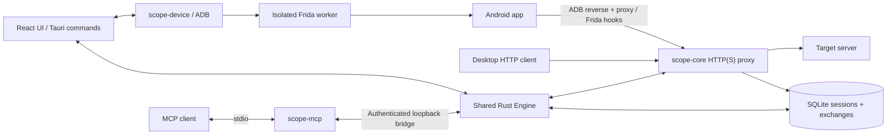

# Architecture

Scope is a local desktop application. A single Rust engine owns capture, session storage, edits and analysis. The Tauri UI and MCP bridge use that same engine, so an agent inspects the archive visible in the app.

## Workspace map

| Path                    | Responsibility                                                                                             |
| ----------------------- | ---------------------------------------------------------------------------------------------------------- |
| `crates/scope-core`     | HTTP(S) interception, CA, breakpoints, replay, SQLite archive, HAR/native formats, analysis and comparison |
| `crates/scope-device`   | ADB discovery, input validation, device setup, owned-resource cleanup and recovery records                 |
| `crates/scope-mcp`      | stdio MCP protocol and twelve tool schemas; calls the desktop's local bridge                               |
| `src-tauri`             | Desktop lifecycle, native dialogs, command dispatch, MCP access policy and local demo server               |
| `src`                   | React inspector, sessions, device setup, analysis, comparison and MCP settings                             |
| `resources/device`      | Frida worker, runtime setup helpers and retained third-party licenses                                             |
| `resources/frida`       | Original Scope Java engine and attributed unchanged Frida Java bridge                                               |
| `examples/android-demo` | Small Java/Android localhost test target                                                                   |
| `scripts/smoke.mjs`     | Real-process MCP/capture/persistence/redaction smoke test                                                  |

## Capture and persistence

The proxy binds loopback by default (`127.0.0.1:17890`). HTTPS uses a Scope-generated CA and generated destination certificates; upstream connections verify their certificates. ADB reverse makes the host proxy reachable from an attached Android device without opening a public listener.

Each exchange has a stable ID and belongs to a saved session. Repeated headers are arrays, and non-UTF-8 bodies use base64. The SQLite database uses WAL mode. Session revisions change when an existing exchange completes or is edited, allowing the UI to refresh a row even when the exchange count stays constant.

Bodies are buffered with an explicit **16 MiB per-body limit**. Oversized bodies fail instead of appearing as successful complete captures. This simplifies editing and durable snapshots, at the cost of memory usage and streaming support. Analysis/import/export currently load session records into memory. Native import consumes its owned exchange values without a second full-tree clone; see the [bounded import memory measurements](NATIVE_IMPORT_MEMORY.md).

Request and response breakpoints hold the corresponding transfer until continued, aborted, timed out or shut down. The timeout is 60 seconds. Edited messages retain original snapshots in the local archive. Replay sends a separate request and records a separate exchange.

Persistent global rules are validated before atomic replacement. Each incoming
request snapshots matching rules; rewrites and synthetic responses precede manual
breakpoints. Rule metadata and original messages survive archive roundtrips.
`completed` distinguishes active transfers from real failures. Restart/import
turns interrupted records into explicit completed errors. Analysis reports mock,
blocked, completed and unfinished counts separately. [Rule semantics](RULES.md)

Session metadata and a bounded 10,000-entry audit journal share the SQLite store.
Audit records contain action, timestamp and optional opaque target ID; traffic,
URLs, package names, rule payloads and credential values are not journaled. This
is a local operational journal, not a tamper-proof compliance audit system.

## Device lifecycle

`scope-device` records previous device state and its owned proxy/reverse/forward/server/certificate resources before mutation. Start and Stop are explicit device operations; listing devices/apps does not install certificates or change the proxy. A root probe may trigger the device's superuser authorization UI.

System proxy mode is device-wide. Frida mode spawns/attaches to the selected package through an external worker and uses supported Java hooks. The worker runs outside the Tauri process to isolate instrumentation failures. It uses a standalone executable when bundled, or a Python fallback. Host and device Frida versions must match.

Frida Stop terminates the exact process spawned by the worker, because created proxy/TLS objects can survive unhooking. Typed capability readiness follows durable spawned-PID recording. A successful exit and matching cleanup receipt are required; worker failure or missing acknowledgment retains target recovery. After restart, only observed absence of a recorded PID in a readable root procfs view can reconcile it automatically; unknown spawn completion requires manual reconciliation. Saved target PIDs are never killed. System proxy mode does not install certificates; legacy owned-CA removal remains supported.

A failed cleanup retains its recovery record and blocks a conflicting new start. Reconnect the same device and retry Stop. Cleanup removes Scope-owned resources and restores recorded settings; it does not stop unrelated Frida servers. [Android details](ANDROID.md)

## MCP boundary

The desktop starts an authenticated HTTP bridge on loopback (`127.0.0.1:17892` by default). It writes a fresh token and endpoint to `mcp-bridge.json`; on Unix the file permissions are `0600`. `scope-mcp` reads this file and translates stdio tool calls to the live engine. This bridge is an internal implementation detail, not a public remote service.

MCP session, write, global-rule and diagnostic permissions live in memory and
reset on desktop restart. Both sessions must be shared for comparison; knowing
an exchange ID does not bypass scope. Global rule reads require their separate
permission, and mutations also require writes. Diagnostics is independently
gated. Output masks known credentials, omits original snapshots and non-JSON
bodies, and bounds JSON bodies to 64 KiB. Raw local storage remains intact.
[MCP configuration and tool reference](MCP.md)

## Local endpoints and files

| Default                             | Purpose                                                  |
| ----------------------------------- | -------------------------------------------------------- |
| `127.0.0.1:17890`                   | Capture proxy                                            |
| `127.0.0.1:17891`                   | Explicitly started local demo target                     |
| `127.0.0.1:17892`                   | Authenticated MCP bridge                                 |
| `scope.sqlite3`                     | Saved sessions and exchanges                             |
| `scope-ca.pem` / `scope-ca-key.pem` | Public CA and private signing key                        |
| `mcp-bridge.json`                   | Current private endpoint/token for companion MCP process |
| `device/device-recovery.json`       | Adapter recovery state, when present                     |

The application settings expose the actual data directory. `--data-dir` or `SCOPE_DATA_DIR` overrides it; `--bridge-port` changes the bridge port. Developer headless flags are documented in [contributing](../CONTRIBUTING.md#headless-and-mcp-smoke-tests).

## Verification and design choices

Tests exercise actual local HTTP and CA-signed HTTPS, rather than only proxy parsers. The release smoke launches the actual desktop engine and MCP executable, tests access/redaction, and reopens the same SQLite archive. Native UI and one rooted Android emulator were checked separately for earlier versions. These historical receipts do not validate the current Scope-owned engine; its real-device acceptance remains NOT RUN. [Recorded results and limits](VERIFICATION.md)

Scope 1.0.0 does not capture WebSocket frames, HTTP trailers, QUIC/HTTP3 or arbitrary TCP/UDP. Windows/Linux runtime parity and physical Android support need evidence from those environments. New networking-stack support should include a minimal reproducible client/server fixture and a cleanup test.
