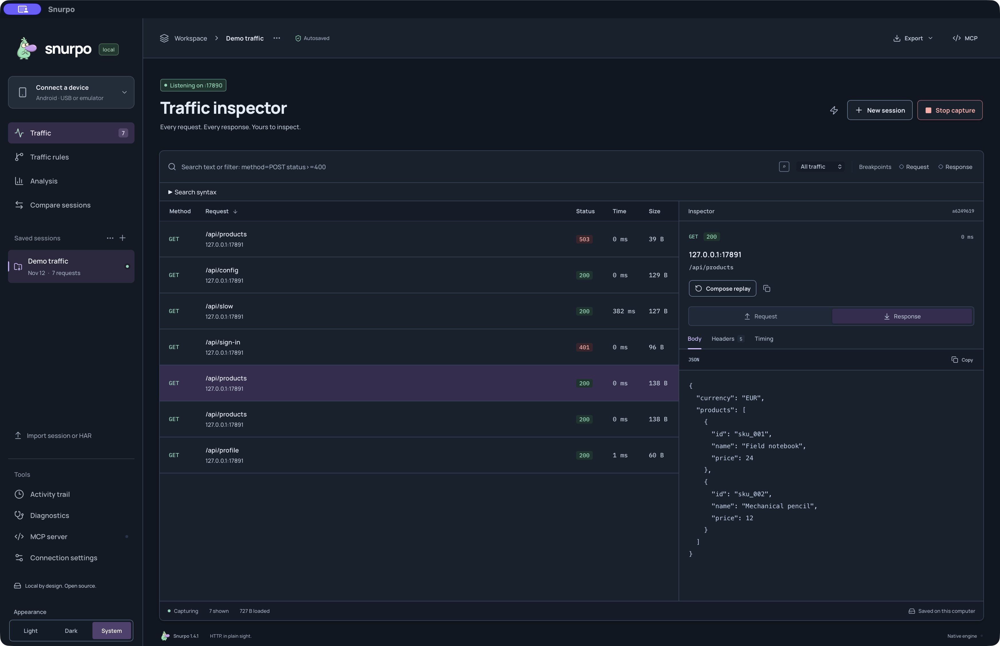
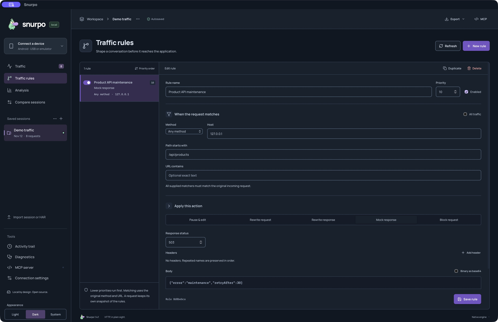
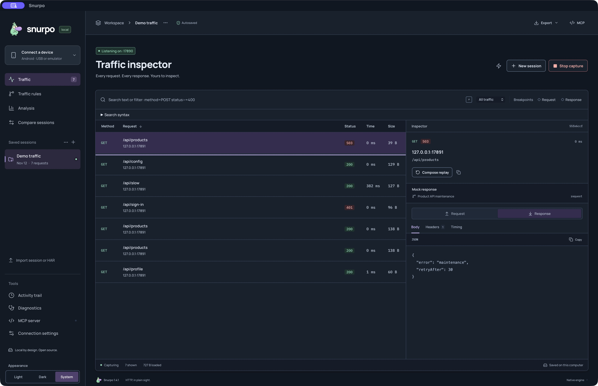
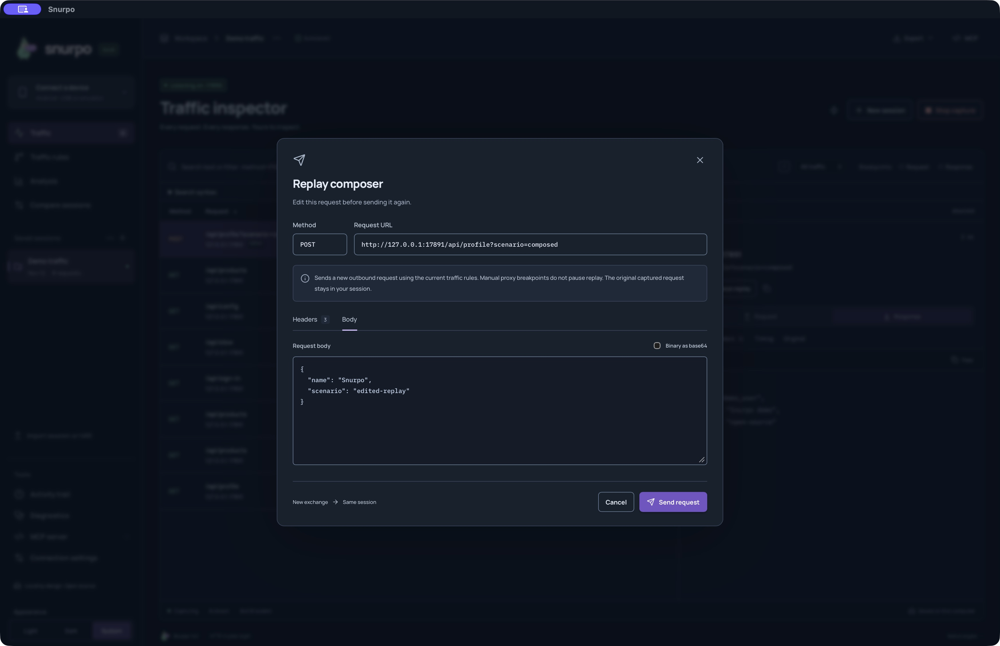
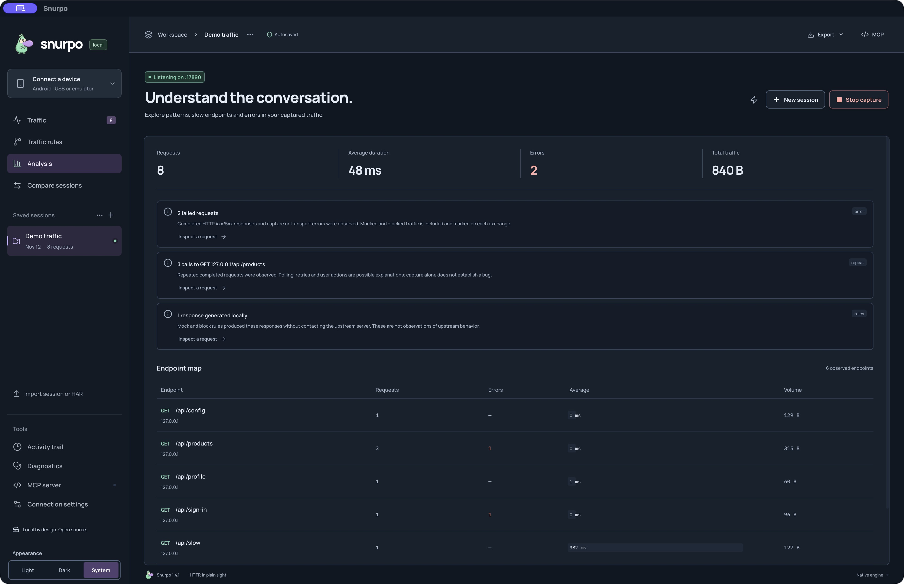

# Snurpo in use

Real captures from the native macOS Snurpo source build, taken on 12 November
2026. The requests are synthetic localhost traffic processed by the actual
engine. These are unreleased source-build screenshots; the latest published
installer remains Scope 1.4.1.

## Traffic inspector

Choose a request and see its response, headers and timing. The selected successful
products response is preserved alongside a later request handled by a mock rule.

## Your rules, saved

The enabled rule matches the local host and products path. Its status and body
are visible together with the saved rule, priority and explicit endpoint scope.

## Make the failure reproducible

The saved **Product API maintenance** rule matches `/api/products` on the local
fixture and returns a JSON 503. A separately issued curl request received that
response. Snurpo marks it as **Mock response**, so it is distinguishable from an
upstream failure.

## Edit. Send. Keep the original.

The edited POST was sent, returned HTTP 200 and became a new exchange in the same
session. This image reopens that saved request in the composer. Current rules
apply to replay; manual proxy breakpoints do not pause it.

## Follow a finding back to its request

Analysis links observed findings to captured requests. Here it distinguishes the
intentional sign-in error, repeated products calls and the locally generated
maintenance response. Counts and timings belong to this eight-request session.

See [capture provenance and reproduction](images/README.md) for exact setup,
source-build isolation and image hashes. These macOS captures do not establish
Windows, Linux or universal Android compatibility.

The earlier Scope 1.0.0 captures remain unchanged for historical reference:
[traffic](images/traffic-inspector.jpg), [rules](images/traffic-rules.jpg),
[replay](images/replay-composer.jpg), [analysis](images/analysis.jpg), and their
[original provenance](images/README.md#historical-scope-100-capture-provenance).
